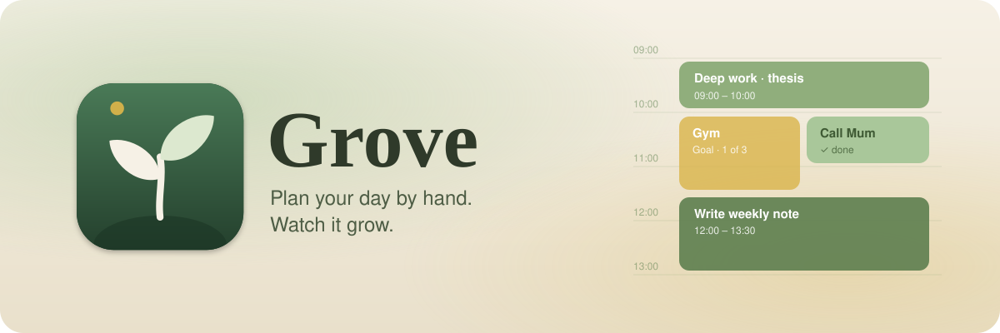
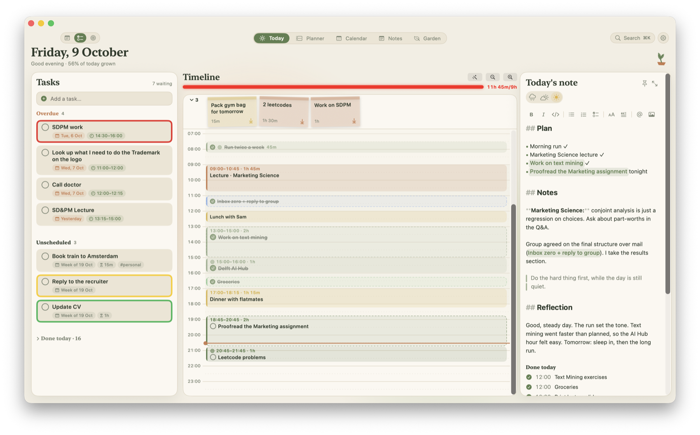
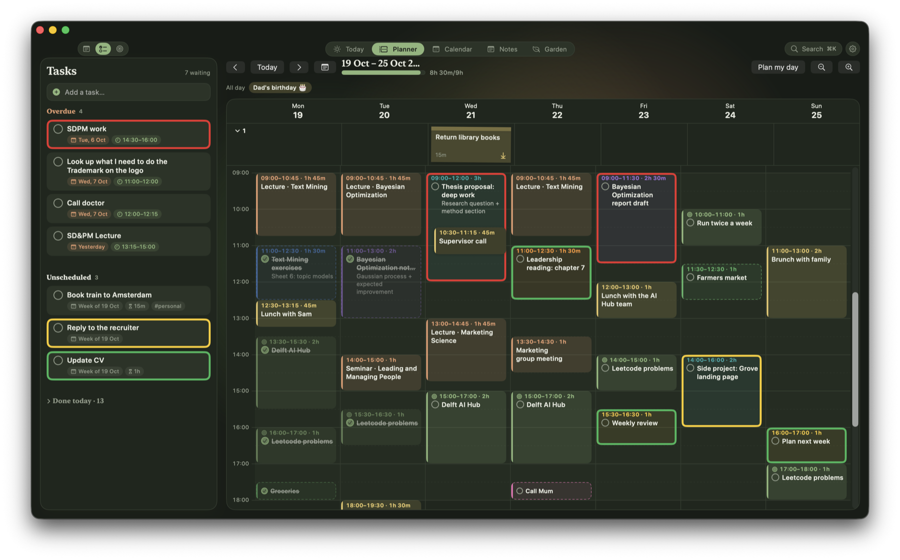
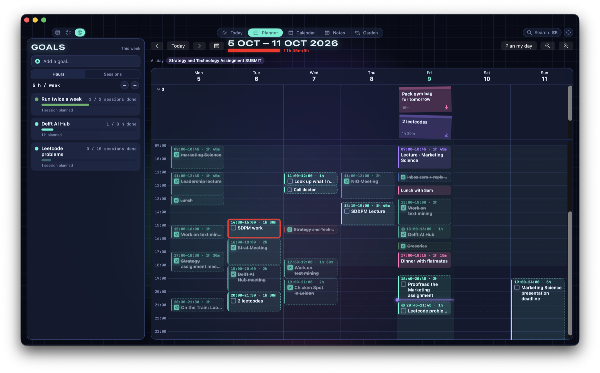
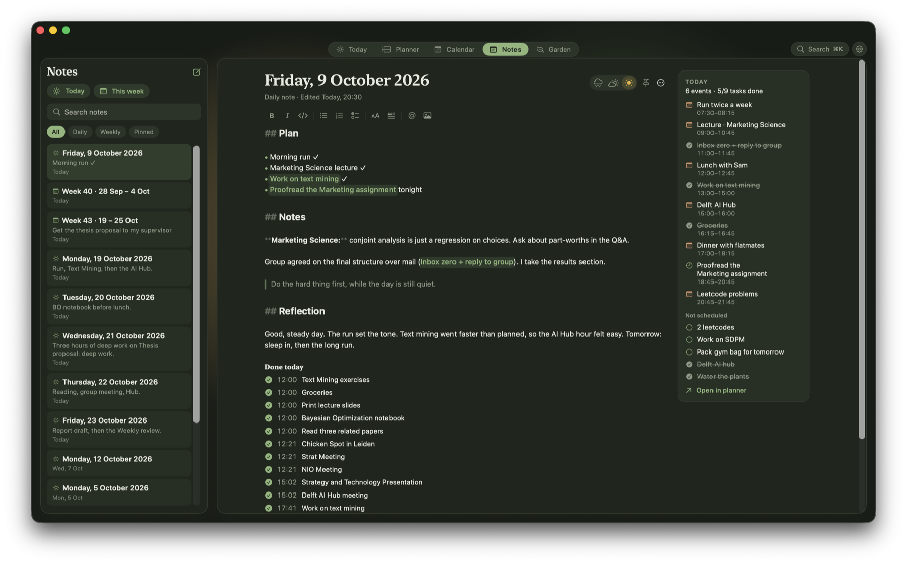
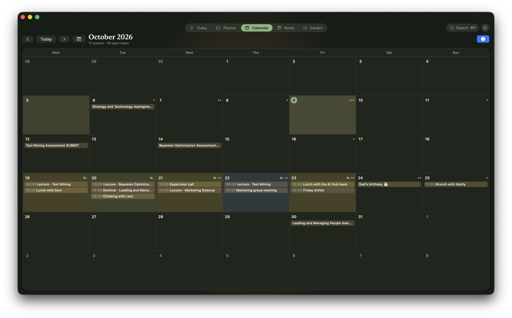
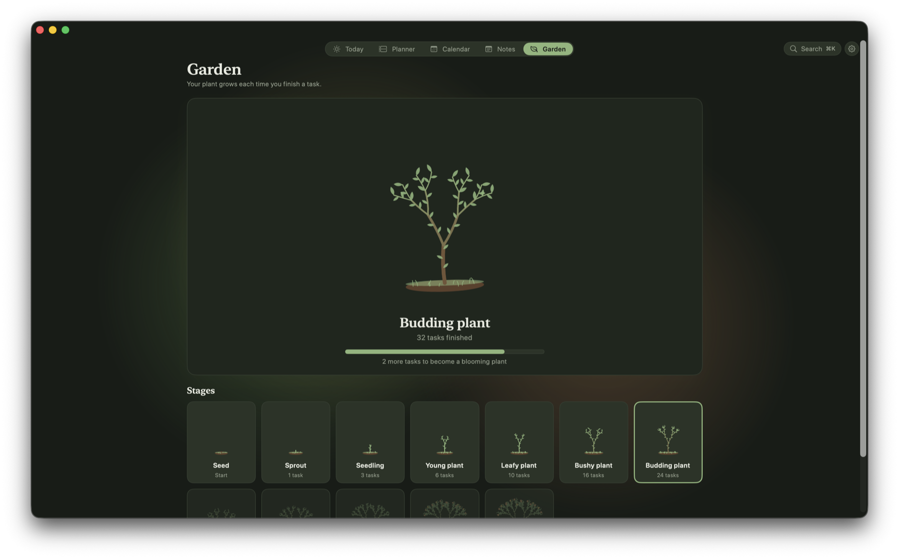
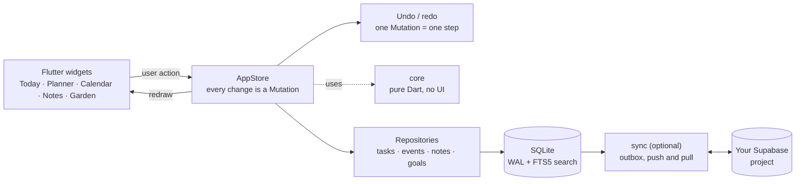

<p align="center">
  <picture>
    <source media="(prefers-color-scheme: dark)" srcset="docs/images/banner-dark.svg">
    
  </picture>
</p>

<h3 align="center">Your day, your tasks, your notes and your goals.<br>One calm place that grows with you.</h3>

<p align="center">
  
  
  
  
  
  
</p>

<p align="center">
  <a href="#-install"><b>Install</b></a> ·
  <a href="#-what-grove-does"><b>Features</b></a> ·
  <a href="#-who-its-for"><b>Who it's for</b></a> ·
  <a href="#-how-it-works-for-the-curious"><b>How it works</b></a>
</p>

<p align="center">
  <picture>
    <source media="(prefers-color-scheme: dark)" srcset="docs/images/today-tab-dark-mode.png">
    
  </picture>
  <br><sub>The pictures on this page are from the first Mac version of Grove. The new app follows the same design.</sub>
</p>

---

## Why Grove

Most planners make you choose. A to-do list *or* a calendar. Notes *or* a schedule.
You end up with five apps, and none of them know about each other.

Grove puts it all in one window, and ties it together.

<table>
<tr>
<td width="33%" valign="top">

### ✋ Plan by hand
Drag a task onto your day. It becomes a block of time.
Drag it to move it. Pull its edge to make it longer.
It snaps to 15 minutes and every move can be undone.

</td>
<td width="33%" valign="top">

### 🔗 Everything connects
A task can live in a note. A note can link to an event.
A meeting block gets its own note with one click.
Nothing is an island.

</td>
<td width="33%" valign="top">

### 🔒 Yours, and only yours
No account needed. No tracking.
Your data lives in one file on your device,
with automatic backups. Sync is there only if you turn it on.

</td>
</tr>
</table>

---

## 🌱 What Grove does

### Today — the Day Planner
The heart of Grove. A timeline of your day, with your tasks on the side.

- **Drag** a task onto the timeline, or drag on empty time to make a block.
- **Move and resize** blocks with the mouse. Blocks can overlap; they sit side by side.
- A **workload bar** shows how full the day is. It turns red when you plan too much.
- Start a **focus timer** on any block.
- Yesterday's unfinished blocks? Grove offers to **roll them over**.
- Planning ahead? The **Today / Tomorrow** switch in the header shows only tomorrow.

### Planner — your week at a glance
Seven days side by side. Drag blocks between days. Zoom in and out with `⌘ =` and `⌘ −`
(`Ctrl` in place of `⌘` on Windows).

<p align="center">
  
</p>

### Tasks that understand you
Type one line. Grove reads it.

```text
Call Mum tomorrow 6pm for 20m #family !2
```

That is a task for tomorrow, with a 20-minute block at 6 pm, a `family` tag and medium priority.
Also understood: `every monday`, `next week`, `someday`, `/list`, dates like `12/10` (day/month).

Lists, tags, priorities, subtasks, due dates, repeating tasks, eight colours, and a
priority outline so the important things stand out.

### Goals — time for what matters
Some things have no date. You just want to do them *enough*.

- Make a goal in **Hours** ("5 h of reading a week") or **Sessions** ("3 gym sessions a week").
- Drag the goal onto your day to plan time for it.
- Tick the block done when you did it.
- The goal shows **done** and **planned** for the week, side by side. Next week starts fresh.

<p align="center">
  
  <br><sub>The Goals panel, here in the Futuristic theme.</sub>
</p>

### Notes, linked to your life
- A **daily note** for every day and a **weekly note** for every week.
- Link anything with `[[double brackets]]`: tasks, events, other notes.
- Checkboxes in a note become real tasks.
- Add images. Tag how the day felt, and tint your calendar by **mood**.

<p align="center">
  
</p>

### Calendar
A month view with your events, a dot for each open task and a leaf for each day with a note.
Click a day to jump to that week.

<p align="center">
  
</p>

### Garden 🌿
Every task you finish helps a small plant grow, through twelve stages.
It is a quiet reward for a good day.

<p align="center">
  
</p>

### Four themes, light and dark
**Grove** (natural, the default), **Minimal**, **Futuristic** and **Vintage**.
Each one has its own colours, fonts and shapes, in a light look and a dark look.
Soft light drifts in the background. Motion can be turned off, and Grove follows
the *Reduce motion* setting of your system.

### Small things that feel good
- **Command palette** (`⌘ K`) to find and do anything.
- A **leaf in the menu bar** (macOS) or the **system tray** (Windows) that shows what is now and what is next.
- **Reminders** for events, blocks and due times.
- **Optional sync** between your devices, with your own free Supabase project.
- **Settings** behind the gear: theme, light or dark, busy-day limit, mood tint and more.
- **Undo everything** with `⌘ Z`.

<details>
<summary><b>Keyboard shortcuts</b></summary>

On Windows, use `Ctrl` in place of `⌘`.

| Keys | Action |
|---|---|
| `⌘ N` | New task |
| `⌥ ⌘ N` | New note |
| `⇧ ⌘ N` | New event |
| `⌘ T` | Today |
| `⌘ 1` … `⌘ 5` | Planner · Tasks · Calendar · Notes · Garden |
| `⌘ K` | Command palette |
| `⌘ =` / `⌘ −` | Zoom the planner |
| `⌘ Z` / `⇧ ⌘ Z` | Undo / Redo |
| `⌘ ,` | Settings |
| `Space` | Tick the selected block done |

</details>

---

## 🙋 Who it's for

- **Time-blockers.** Students, makers, freelancers and anyone who plans the day in blocks.
- **People tired of five apps.** Tasks, calendar, notes and goals in one window.
- **Privacy people.** Your plans stay on your device. They leave it only if you turn sync on.
- **People with more than one device.** One app for Mac, Windows, Android and iPhone.

---

## 📦 Install

Grove is one app for four systems. It is built with [Flutter](https://flutter.dev).
There is no ready-made download yet, so you build it from the source. That takes a few commands.

| Platform | Status | How |
|---|---|---|
| 🍎 **macOS** 12+ | ✅ Works | [Build from source](#macos) |
| 🪟 **Windows** 10 / 11 (64-bit) | 🧪 Builds and passes its tests on a build server. Not yet tried by hand on a PC. | [Build from source](#windows) |
| 🤖 **Android** | 🧪 Builds and passes its tests on a build server. Not yet tried by hand on a phone. | [Build from source](#android) |
| 📱 **iOS / iPadOS** 15+ | 🧪 Builds without a signature. You sign it with your own Apple ID. | [Build from source](#ios-and-ipados) |

### Before you start

1. Install [Git](https://git-scm.com/downloads).
2. Install [Flutter](https://docs.flutter.dev/get-started/install) 3.47 (the stable channel).
3. Run `flutter doctor`. It tells you what is missing for your system.
4. Get Grove:

```bash
git clone https://github.com/AndreiOprescu/Grove.git
cd Grove
```

### macOS

You need a Mac with macOS 12 or newer and [Xcode](https://apps.apple.com/app/xcode/id497799835).

One command builds Grove, puts it in `~/Applications`, adds a **Grove** icon to your
Desktop and opens it:

```bash
./scripts/flutter_install.sh
```

The first build takes a few minutes.

Or do the steps by hand:

```bash
# 1. Build
./scripts/flutter_build.sh macos

# 2. Put the app in your Applications folder
ditto app/build/macos/Build/Products/Release/Grove.app /Applications/Grove.app

# 3. Open it
open /Applications/Grove.app
```

### Windows

You need Windows 10 or 11 (64-bit) and
[Visual Studio 2022](https://visualstudio.microsoft.com/downloads/) with the workload
**Desktop development with C++**. A Windows app can only be built on Windows.

Run this in PowerShell, in the `Grove` folder:

```powershell
cd app
flutter pub get
flutter build windows --release
```

The app is the folder `app\build\windows\x64\runner\Release`. Copy the **whole folder** to a
place you like, for example `%LOCALAPPDATA%\Grove`. Then start `grove.exe` in that folder.
`grove.exe` does not run alone: it needs the files next to it.

### Android

You need [Android Studio](https://developer.android.com/studio). It brings the Android SDK
and Java.

```bash
# 1. Build the APK (the install file)
./scripts/flutter_build.sh android

# 2. Connect the phone with USB debugging on, then install
adb install app/build/app/outputs/flutter-apk/app-release.apk
```

No cable? Copy `app-release.apk` to the phone and open it there. Android asks you to allow
the install first.

> [!WARNING]
> The APK is signed with the test key of **your** computer. An APK that was built on
> another computer cannot update it. Android then makes you remove Grove first, and
> **its data goes with it**. Always build your updates on the same computer.

### iOS and iPadOS

You need a Mac with Xcode, an iPhone or iPad with iOS 15 or newer, and an Apple ID.
Apple lets only signed apps run on a phone, so you sign Grove with your own Apple ID.

```bash
cd app
flutter pub get
open ios/Runner.xcworkspace
```

In Xcode:

1. Select **Runner** ▸ **Signing & Capabilities**.
2. Pick your **Team** (your Apple ID).
3. If Xcode says the bundle identifier is taken, change it to one of your own.

Then connect the device and run:

```bash
flutter run --release
```

With a free Apple ID the app stops after 7 days. Then you run the command again.
A paid Apple Developer account gives one year.

### Update

```bash
git pull
```

Then build and install again, the same way. Your data stays where it is.

One exception: a build from before 2026-10-12 had another app id. On a Mac, a newer build
starts with an empty data folder. On a phone, the newer build is a second app beside the old
one. Before you update such a build, use **Settings ▸ Data ▸ Export JSON…** in the old app.
After the update, use **Import JSON…** in the new one. The steps are in
[`docs/acceptance/retire-swift.md`](docs/acceptance/retire-swift.md).

### Where your data is

| System | Place |
|---|---|
| macOS | `~/Library/Containers/local.grove.app/Data/Library/Application Support/local.grove.app/` |
| Windows | `%APPDATA%\local.grove\Grove` |
| Android, iOS | Inside the app. It goes away when you remove the app. |

The file is `grove.sqlite`. Grove makes a backup each day and keeps the newest 14 in `Backups`.
On a Mac and on Windows, **Settings ▸ Data ▸ Show data folder** opens the place.

### Uninstall

Quit Grove and delete the app (`/Applications/Grove.app` or `~/Applications/Grove.app` and
the **Grove** icon on the Desktop, or your Windows folder, or the app on your phone). On a
Mac and on Windows your data stays in the folder above. Delete that folder only if you want
to erase everything.

### Sync between your devices (optional)

Grove works with no account. If you want the same data on all your devices, Grove can sync
through [Supabase](https://supabase.com). You make your own free Supabase project, so your
data is on a server that is yours.

> [!NOTE]
> Sync is new. It passes its tests against a test server. It is not yet proven against a
> real Supabase project. Keep a backup until it is.

1. Make a free project at [supabase.com](https://supabase.com).
2. Open **SQL Editor**. Paste the whole file
   [`supabase/migrations/20261011000000_grove_sync.sql`](supabase/migrations/20261011000000_grove_sync.sql)
   and run it.
   Then do the same with
   [`supabase/migrations/20261012000000_grove_sync_goal_subtasks.sql`](supabase/migrations/20261012000000_grove_sync_goal_subtasks.sql),
   and then with
   [`supabase/migrations/20261013000000_grove_sync_goal_subtask_block.sql`](supabase/migrations/20261013000000_grove_sync_goal_subtask_block.sql).
   Sync works only after all three files.
3. Open **Authentication ▸ Emails ▸ Templates**. In "Magic Link" and in "Confirm signup",
   add this line: `Your code for Grove: {{ .Token }}`
4. Make the key file and fill in the two fields:

   ```bash
   cp app/config/supabase.example.json app/config/supabase.json
   ```

   `SUPABASE_URL` is the "Project URL". `SUPABASE_ANON_KEY` is the `anon` `public` key.
   Never use the `service_role` key. Git ignores this file; never commit it.
5. Build again. `./scripts/flutter_build.sh` finds the file by itself. On Windows, add
   `--dart-define-from-file=config/supabase.json` to the build command.
6. In Grove, open **Settings ▸ Sync**. Type your email, then type the code from the email.

A build with no key file has no sync.
The full steps are in [`docs/acceptance/F11-login.md`](docs/acceptance/F11-login.md).

### Nothing is signed yet

No build has the signature of a known developer. On the computer that built it, the app
just runs. If you **download** a build that another computer made:

- **macOS** stops it. Allow it in **System Settings ▸ Privacy & Security ▸ Open Anyway**.
- **Windows** shows "Windows protected your PC". Click **More info ▸ Run anyway**.
- **Android** installs it by hand only. See the warning above.
- **iOS** cannot install it at all without your own signature.

---

## 🔧 How it works (for the curious)

Grove is a Flutter app, written in Dart. One code base draws the same screens on all four
systems. It lives in [`app/`](app/).



**Layers.**
- `lib/core` is pure Dart with no Flutter imports. It holds the models, the planner maths
  (snapping, overlap columns, free time), the quick-add parser, repeat rules and the garden.
- `lib/data` is the database: migrations, repositories, search, backups, export and import.
- `lib/state` is the `AppStore` and its rules.
- `lib/sync` is the sync engine. `lib/services` talks to the system: reminders, the tray,
  the window, Supabase.
- `lib/ui` is the screens, the editor and the four themes.

A check in the test script keeps Flutter out of `core`, `data` and `sync`.

**One way to change data.** Every edit is a `Mutation` sent through `commit`. That gives
undo and redo for free, and keeps the database and the screen in step.

**SQLite, with no ORM.** Grove talks to SQLite through the `sqlite3` package. The schema
moves forward with numbered migrations. Full-text search uses an FTS5 table.

**Local first.** The database on your device is the truth. The app works with no network.
With sync on, each change waits in an outbox and goes to the server when it can. If two
devices change the same thing, the last write wins.

**Few packages.** Eight, all listed in [`app/pubspec.yaml`](app/pubspec.yaml): SQLite,
Supabase, notifications, time zones, the tray, file pickers, paths and links. The fonts
are bundled and open (OFL).

**Art in code.** The app icon is drawn by `scripts/make_flutter_icons.swift`. The garden,
the plant and the drifting background light are drawn at run time.

**Tested.** 2456 tests. The script also checks the format and runs the analyzer:

```bash
./scripts/flutter_test.sh
```

When the app changes, GitHub Actions runs the tests and builds it for all four systems.

<details>
<summary><b>Project layout</b></summary>

```text
app/                 the Flutter app (all four systems)
├─ lib/
│  ├─ core/          pure Dart: model, parsing, planner, recurrence, services
│  ├─ data/          SQLite, migrations, repositories, search, backup, export
│  ├─ state/         AppStore, undo, rules
│  ├─ sync/          outbox, push and pull, last write wins
│  ├─ services/      reminders, tray, window, Supabase
│  └─ ui/            planner · tasks · calendar · notes · goals · garden ·
│                    editor · settings · shell · theme · auth
├─ test/             unit, widget and golden tests
├─ config/           supabase.example.json (your key file goes here)
└─ macos/ windows/ android/ ios/    the native shells
supabase/            the SQL for your sync project
scripts/             flutter_build.sh · flutter_test.sh · flutter_release.sh ·
                     flutter_install.sh · make_flutter_icons.swift
docs/                plan, decisions (ADR), assumptions, acceptance proof
```

</details>

---

## 🗺️ Roadmap

- [x] Day Planner, tasks, calendar, notes, goals, garden
- [x] Four themes, each in light and dark
- [x] One app for macOS, Windows, Android and iOS with Flutter
- [x] Optional sync between devices (built and tested)
- [ ] Prove sync against a real server
- [ ] Try the app by hand on a Windows PC, an Android phone and an iPhone
- [ ] Ready-made, signed downloads

---

## 📄 License

Grove is free and open source under the [MIT License](LICENSE).

---

<p align="center">
  <sub>Made with care by <a href="https://github.com/AndreiOprescu">Andrei Oprescu</a>. Grown, not built. 🌱</sub>
</p>
